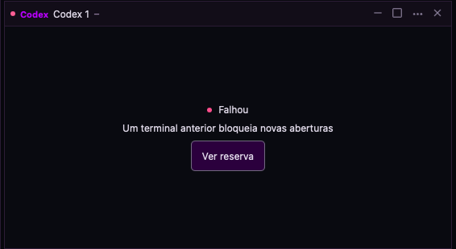
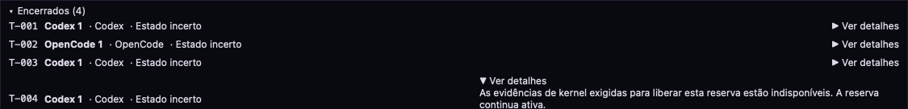

# Studio admission blocked by a legacy reservation

> **Superseded for Studio on 2026-11-19.** The
> [managed terminal lifetime decision](t3-terminal-lifetime.md) supersedes
> the cross-launch release model. The following text records the original contract.

The diag30 baseline is `origin/integrate/spec` at `1610bb9`. The native Preview
has one active admission marker. It references T-004, the Codex terminal
documented in [diag28](diag28-lifecycle.md#historical-diag28-t-004).
T-001 through T-003 have saved Feature memberships and no durable release
for those memberships. The four rows do not represent four active markers.

## Why every open fails

`prepareTauriTerminals` calls `inspectDesktopAdmission` before dispatch. There is
one exclusive `managed-agents/active-pair.json` claim per AppData namespace.
An existing marker only permits incremental enrollment when its owner, epoch
and initial manifests match the current private Core. After a relaunch there
is no matching Core. The preflight reports `capacity_reserved` before any new
terminal process starts. Additional Features, Workspaces, and provider choices
share this namespace. The limit on the number of slots is checked separately.

Studio now explains the blocking reservation on the failed opening card.
**Ver reserva** opens the matching **Encerrados** entry when native startup can
bind the marker to a saved member. **Ver detalhes** reports unavailable kernel
evidence. Saved names come from the exact Feature layout. Provider and active
marker association come from bounded reads of native terminal manifests
correlated with the saved terminal UUID and workspace project. These are
display facts. Release, exit, and readiness still require their existing
durable evidence.

## Recovery boundary

The real T-004 manifest has a format-1 lifecycle receipt with prepared, armed,
started and SIGTERM exit records. It has no kernel identity receipt. The
historical process list in diag28 cannot supply the original boot, exact
kernel process starts and complete session inventory for the old Core,
supervisor and leader. A leader exit does not establish that the entire
session is absent or that every producer is fenced. A confirmation cannot
supply this missing evidence.

The existing [offline administrative path](../api/offline-native-recovery.md)
requires a trusted pre-reboot capture, strict eligible non-dispatch evidence,
a different kernel boot and distinct native approvals for capture, release
preparation and finalization. It cannot be composed as a one-click release of
this started legacy member. ORQST's separate kernel-recovery branch
(`origin/feat/kernel-reservation-release` at
`2e51b0834692aafc04f76221dd51e329aa1592ee`) documents the one-review design
in `docs/api/kernel-reservation-recovery.md`. Its `inspectKernelMember`,
`verify_sessions` and `releaseKernelReservation` require paired lifecycle
and kernel receipts, two complete session scans, an exclusive mutation lock
and revalidation before archival. The branch explicitly excludes legacy
markers without those receipts. The legacy PTY also has no authenticated
cross-launch reattach or stop channel.

For this real state, the owner can click **Ver reserva** on the failed
opening card, or **Encerrados → T-004 → Ver detalhes**. The entry remains
**Estado incerto**. There is no approval button or safe batch release for the
legacy data. A full in-app release path remains open work. The Preview leaves
the real admission marker and terminal receipts in place.

## The 30-minute lifetime is a blocker

The default Node PTY host starts its 30-minute timer after spawn. It sends
SIGTERM through the owned PTY handle, then SIGKILL five seconds later if the
leader has not exited. The IPC disconnect callback separately resumes PTY
drain. It does not start or reset the timer. A normal attached session can
therefore be terminated at 30 minutes. The opt-in Rust terminal backend
also starts its 30-minute timer at start and executes the same escalation
while attached. The diag28 SIGTERM timing matches the unconditional Node
deadline. This change reports the blocker and preserves the lifetime policy.

## Reuse review

Anywh at `16d572d247ef16b79431c1ffe5695a8a1b57c913` documents the agent host
and runtime entry points in its [architecture](https://github.com/anywh-sh/anywh/blob/16d572d247ef16b79431c1ffe5695a8a1b57c913/docs/architecture.md),
[Agent Host](https://github.com/anywh-sh/anywh/blob/16d572d247ef16b79431c1ffe5695a8a1b57c913/docs/agent-host.md)
and [runtime contract](https://github.com/anywh-sh/anywh/blob/16d572d247ef16b79431c1ffe5695a8a1b57c913/relay/src/runtimes/README.md).
Its [instance lock](https://github.com/anywh-sh/anywh/blob/16d572d247ef16b79431c1ffe5695a8a1b57c913/relay/src/agentHost/instanceLock.ts)
uses Node fs, net and crypto. Off Linux, the PID file can have competing stale-lock
claimants. [AgentHost.start and restore](https://github.com/anywh-sh/anywh/blob/16d572d247ef16b79431c1ffe5695a8a1b57c913/relay/src/agentHost/agentHost.ts#L280-L349)
sweep marked processes and restore the registry. [sweepAgentProcesses](https://github.com/anywh-sh/anywh/blob/16d572d247ef16b79431c1ffe5695a8a1b57c913/relay/src/agentHost/processTree.ts#L174-L184)
uses Linux `/proc` marker matching and signals. The [terminal attachment](https://github.com/anywh-sh/anywh/blob/16d572d247ef16b79431c1ffe5695a8a1b57c913/relay/src/host/terminalSession.ts#L61-L117)
uses `node-pty` with a named tmux session. The reviewed tree has an
[Apache-2.0 license](https://github.com/anywh-sh/anywh/blob/16d572d247ef16b79431c1ffe5695a8a1b57c913/LICENSE)
and no root NOTICE. ORQST keeps its private evidence readers and admission
guards because PID locks, signal sweeps and named sessions lack its historic
identity and owner review. This increment incorporates no external code,
dependencies or assets.

## Packaged acceptance

An ad-hoc-signed, separately named debug Preview used the coordinated Cargo
target and the original Preview bundle identifier to read the live reproduction.
The existing Preview was closed. No root `pnpm build` ran. The new bundle was
launched, Studio was driven through the supplied AppleScript accessibility tool
and a focused mouse click submitted the opening attempt. Native diagnostics
recorded `admission_preflight / capacity_reserved / not_started`. The failure
card led to T-004 and expanded its details. AppleScript Quit returned `-128` while
AppKit routed termination through the native Quit hook. The packaged app
then exited and the admission marker retained its original SHA-256. Available
disk space was 5.8 GiB before resource staging, 5.4 GiB after packaging and
6.4 GiB after the test bundle was removed.

The screenshots are cropped to the relevant interface. The native confirmation
sheet could not be reached for this legacy reservation. No owner approval was
given, and no new terminal was dispatched.

## Checks

The automated checks exercise display metadata, scope, missing evidence and
capacity refusal. The existing offline recovery tests exercise signed archival
of independently eligible synthetic data under the older cross-boot protocol.
They do not constitute verification of an in-app release.

| Check                                            | Passed | Failed | Skipped or ignored |
| ------------------------------------------------ | -----: | -----: | -----------------: |
| Node, complete suite with `--test-concurrency=1` |  1,599 |      0 |                  0 |
| Chromium, complete suite with `--workers=1`      |    232 |      0 |                  4 |
| Tauri Cargo with `--test-threads=1`              |    203 |      0 |                  2 |
| Rust terminal Core Cargo with `--test-threads=1` |     71 |      0 |                  1 |

Lint, typecheck, dashboard resource staging and the isolated Preview package
passed. Rust reported a debug-stripping warning for missing `libLLVM.dylib`;
the build and test commands exited successfully.
