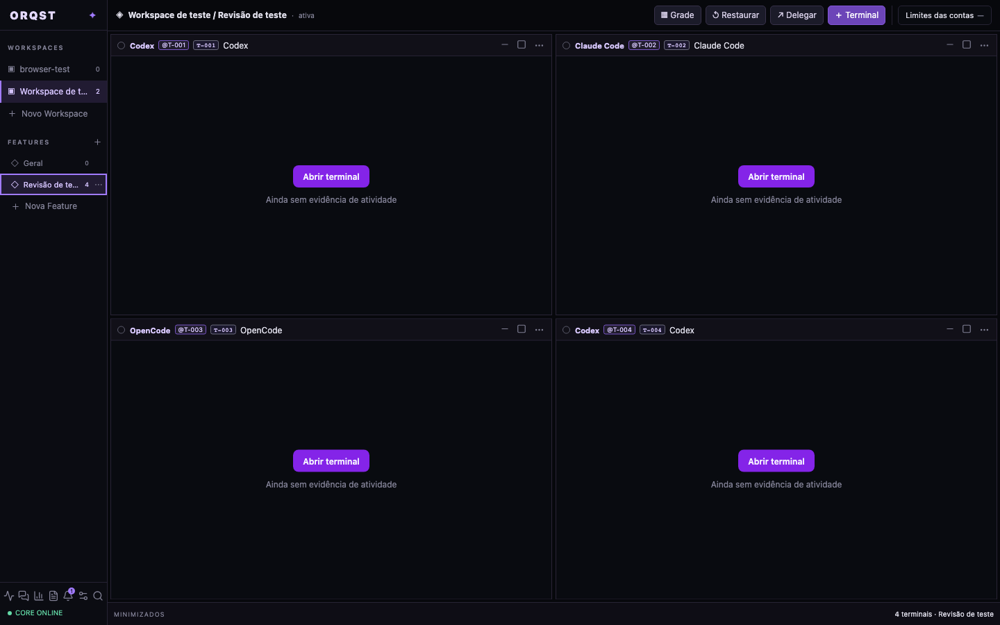
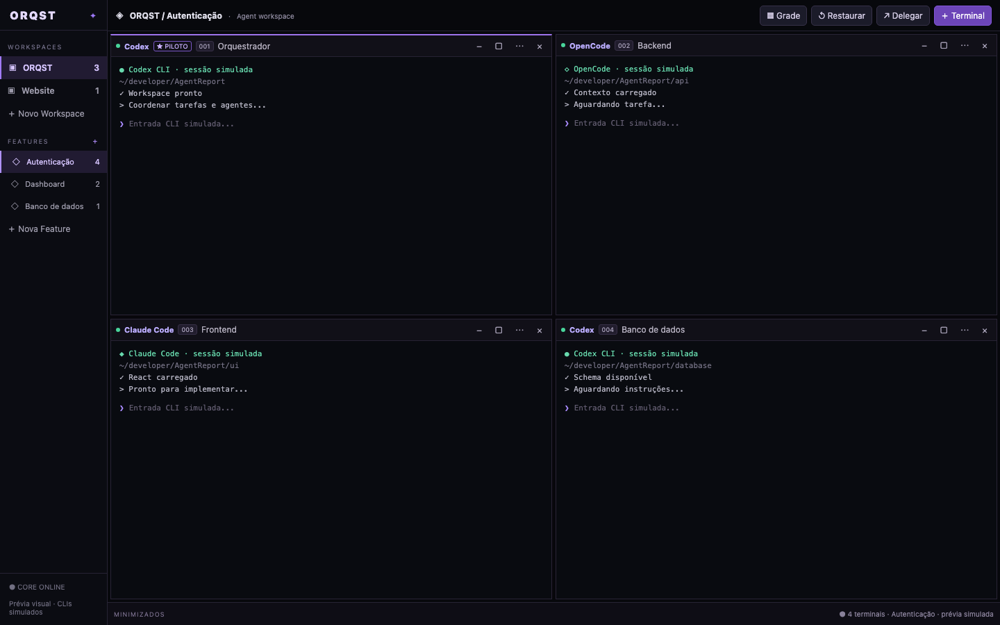
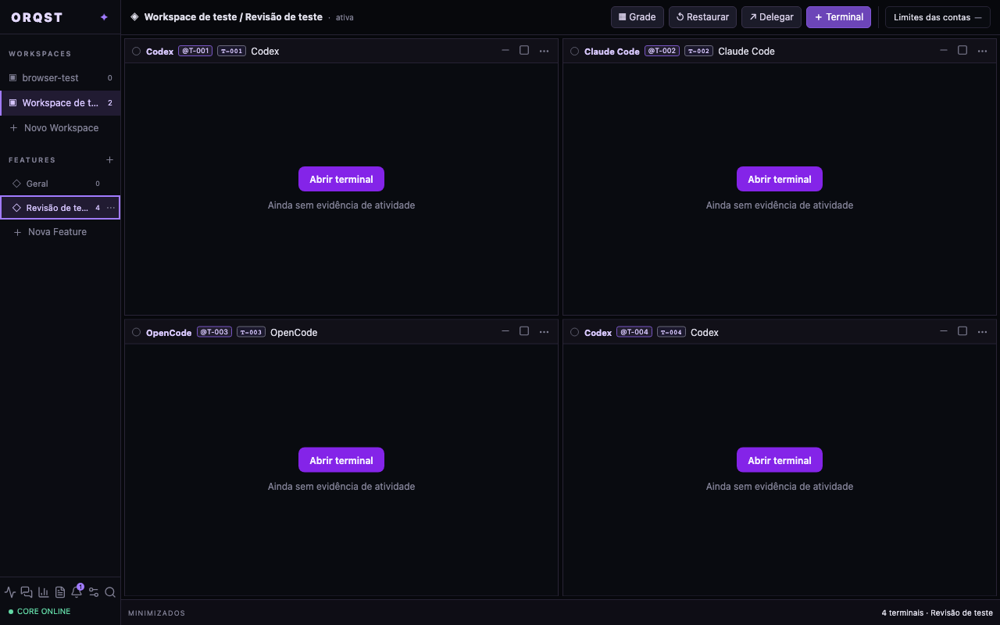
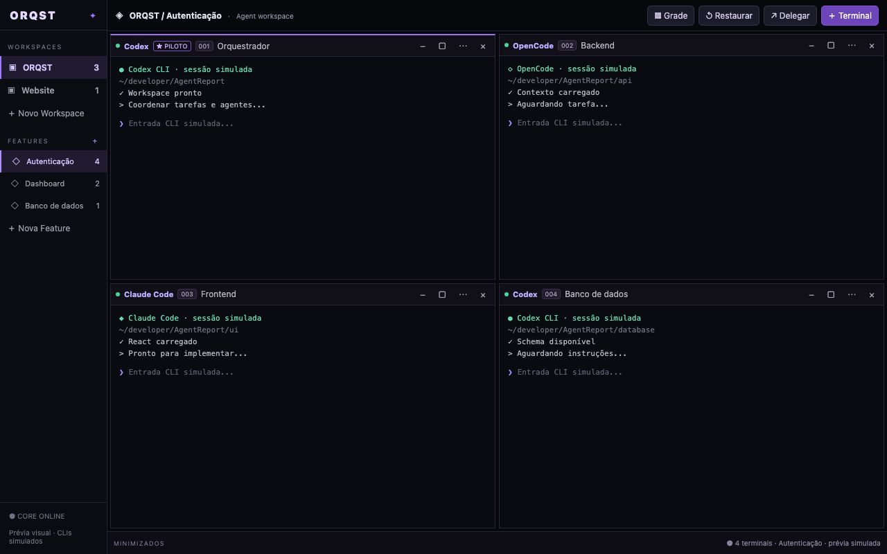
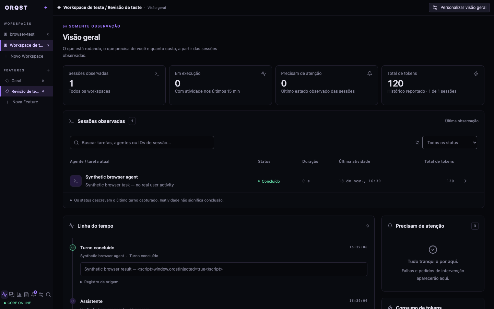
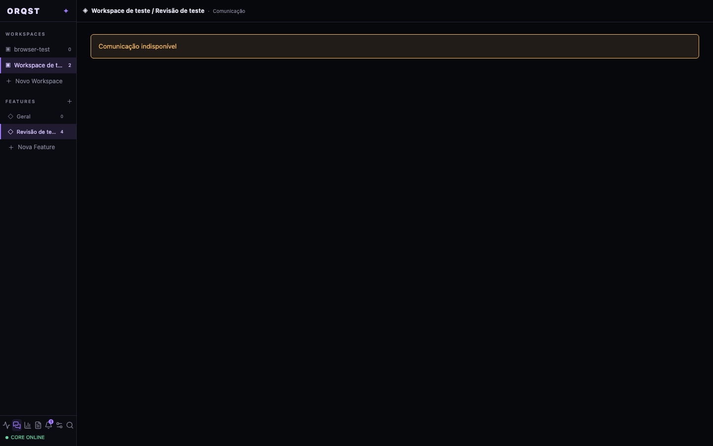
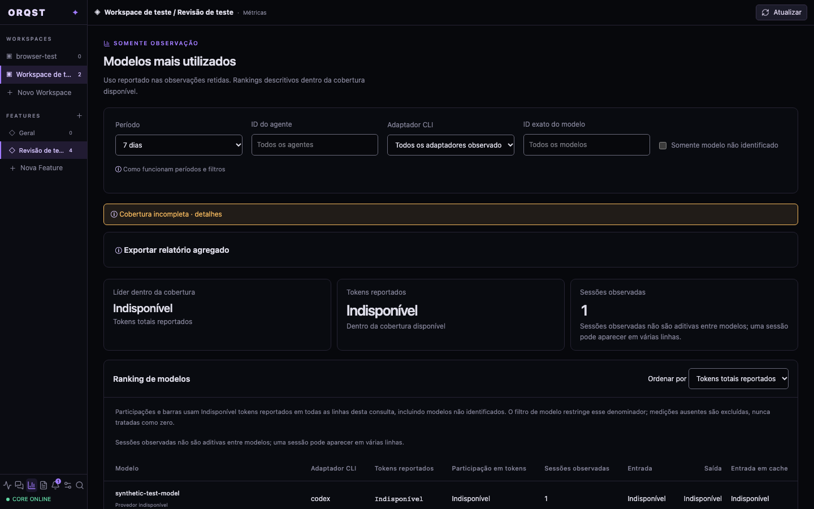
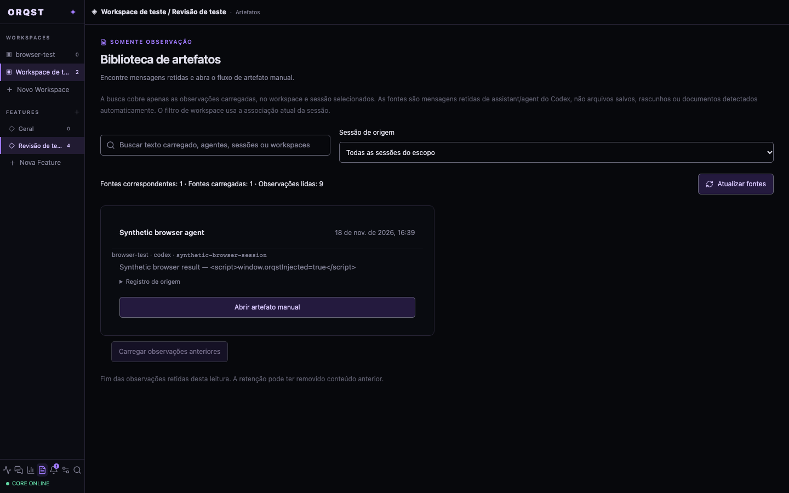
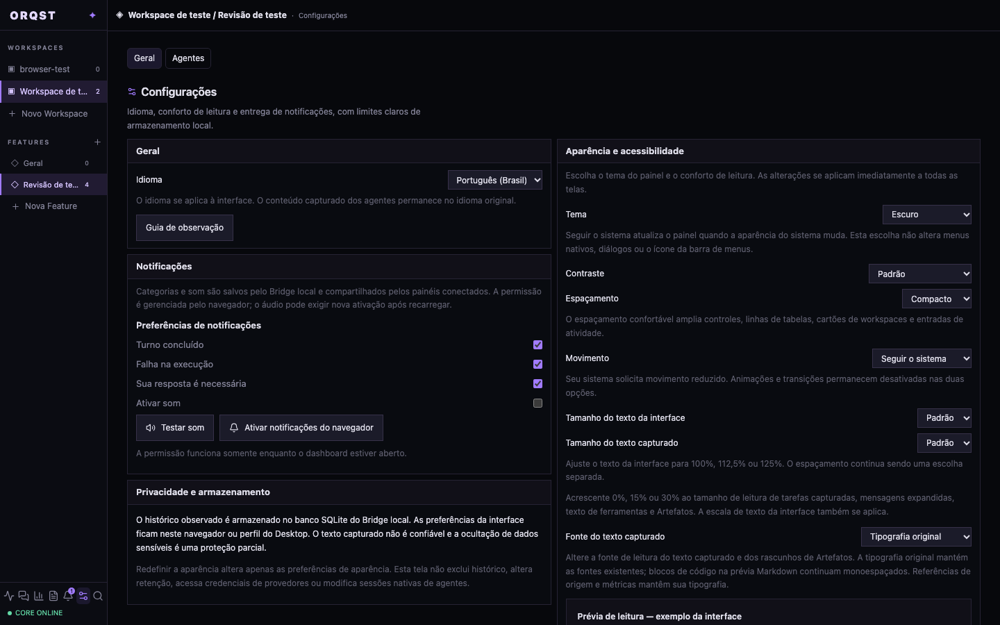

# ORQST specification L1 — shell parity

The screenshots pair the built dashboard with the approved V6 HTML. Both
were captured in Chromium with PT-BR interface copy, dark mode and reduced
motion. The dashboard uses the disposable Bridge and native Feature facades
in `tests/browser/shell-navigation.spec.ts`. Terminal configuration and
session data are synthetic.

| Viewport   | Dashboard                                                 | Approved V6 HTML                                   |
| ---------- | --------------------------------------------------------- | -------------------------------------------------- |
| 1440 × 900 |  |  |
| 1280 × 800 |  |  |

Both captures assert a 155 px sidebar, a 44 px brand row, and a 45 px header.
The dashboard also checks the 46 px rail at a narrow viewport, the owner-specified
footer controls and the Studio header action order. The stage shows the retained
renderer using the test facade's terminal cards.

## Shared frame on the other routes

Each route below is captured at 1440 × 900 beside the same approved Studio
frame. These images show the common sidebar, breadcrumb and footer navigation.
The route bodies come from the L1 branch. Comunicação has the route outlet
ready for L4's Inspector.

| Route         | Dashboard                                            | Approved V6 Studio                     |
| ------------- | ---------------------------------------------------- | -------------------------------------- |
| Visão geral   |       |  |
| Comunicação   |  |  |
| Métricas      |           |  |
| Artefatos     |        |  |
| Configurações |     |  |

## Route integration

Mount route content in the outlet in `App.tsx`. Route components can render
`<RouteHeaderActions>` from `AppShell.tsx` to place their controls in the
shared header. The portal follows the route component's lifecycle. The embedded
Studio uses this slot for its existing controls.
The separate host presentation retains its own frame until the native Studio
integration lane lands.

The footer owns navigation and the notification trigger. The shell owns the
navigable Communication slot and the Settings → Agents subroute. Inspector,
settings and metrics page bodies and native terminal behavior have their own
implementation lanes.

The Core contract supplies the selected managed Workspace, Features and
open slot membership. Workspace counts cover Features registered in this
shell. Observer-only rows have zero registered Features. The native source policy allows the trusted dashboard
routes to read and edit Feature tree metadata. Terminal and arrangement actions
retain their existing source and focus requirements. Observer workspaces retain their existing local metadata
creation path. A native folder picker, provisioning managed Workspaces,
removing Features or moving live terminals during archive require Core
operations that are absent from this branch's base. Duplicate creates a new
Feature with the supplied metadata.

## Reproduce

```sh
pnpm --filter @orqst/dashboard build
ORQST_BROWSER_PORT=4398 ORQST_SPEC_L1_CAPTURES=1 pnpm exec playwright test tests/browser/shell-navigation.spec.ts --workers=1
```

## Verification

- `pnpm lint` and `pnpm typecheck` completed successfully.
- The dashboard Vite build completed with its chunk-size advisory.
- The dashboard route, shell preference and observed-session tests passed 10/10.
- Chromium passed 29 targeted tests across shell navigation, direct paths and
  Studio workspace, with one worker. Both viewport comparisons also assert the
  Studio button order, the limits divider, the Feature count, the right-click
  Feature menu and the absence of the legacy dashboard chrome.
- The captures use browser facades. The native Tauri allowlist tests require a
  Rust toolchain, which was unavailable in this worktree environment.
