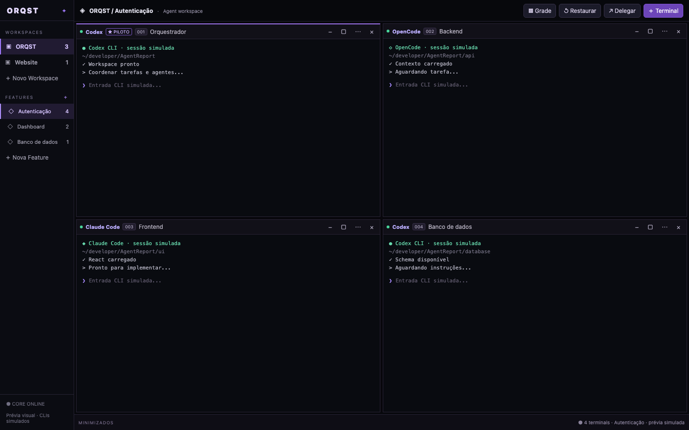
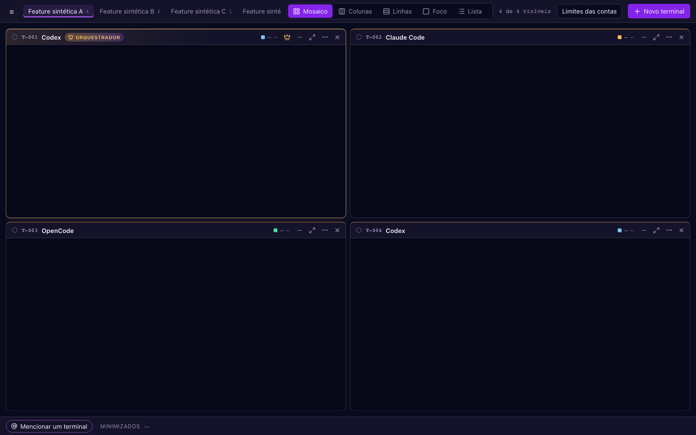
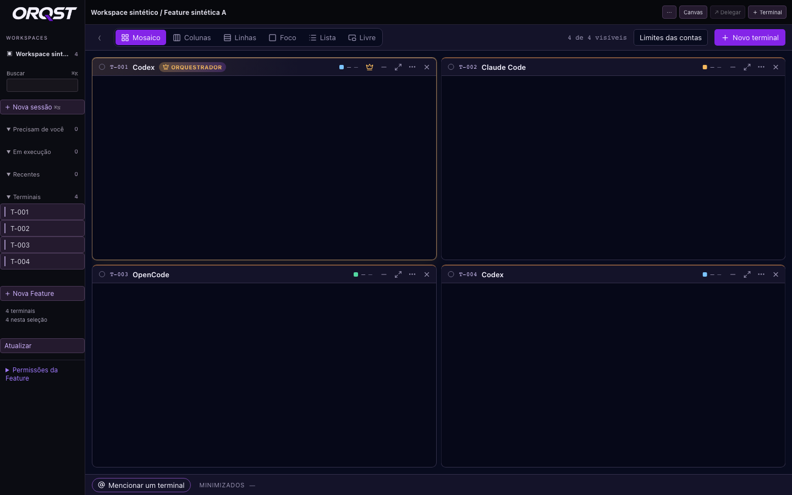

# ORQST V6 visual parity audit

2026-11-18 · Audited source `263c88183faf711fba1d7861f6c5097aab720599` on
`origin/feat/frontend-768` · Documentation and screenshot evidence only.

**Verdict.** The owner's report is reproducible in Chromium. The shipped source
selects the immersive terminal UI on a clean profile. The compact V6 shell still
exists in pieces, but is hidden behind the hamburger and has a different
navigation hierarchy when opened. The renderer and the native Feature document
also use different entry points. Changing the dashboard route alone would leave
the native chrome shown in the complaint untouched.

| Approved HTML | Current Tauri Feature chrome, clean profile | Current chrome, panel open |
| --- | --- | --- |
|  |  |  |

## Method and evidence boundaries

The [six preserved V6 sources](../design/v6/README.md),
[Feature UI increment](../design/v6/feature-ui-increment.md) and
[Feature checklist](../architecture/v6-feature-checklist.md) govern the audit.
The [dashboard alert review](dashboard-alerts-review.md) documents the existing
renderer facade and synthetic terminal preview. Its expanded-shell dimensions
describe that specific state. A clean-prefs audit exercises the default first.

- **Approved** serves the original HTML bytes with fresh storage. It is an
  interactive Studio only, in Portuguese. Settings, notification center,
  account limits and other observer screens have written requirements or existing
  renderer surfaces. The comparison table says where the approved PNG is
  unavailable. The reference’s browser prompts illustrate the creation and close sequence.
- **Tauri Feature chrome** uses the production
  [FeatureWorkspace mount](../../apps/dashboard/src/feature-workspace-mount.tsx)
  and its CSS in an in-memory esbuild wrapper, with the same facade pattern as
  [studio-native.test.ts](../../tests/studio-native.test.ts). The native logo is
  served from the repository SVG over loopback for Chromium. Synthetic Feature,
  pane and limits snapshots drive real React components. The no-limits default
  and the fixture-populated limits panel were captured separately. Native PTY
  holes are intentionally empty in Chromium. The child-document integration
  source is [feature-workspace-client.ts](../../apps/tauri/src/feature-workspace-client.ts)
  and [features.rs](../../apps/tauri/src-tauri/src/features.rs).
- **Tauri dashboard Studio** uses the built dashboard's real `/studio` route,
  the Tauri user-agent token and in-memory facades, following the
  [browser Studio tests](../../tests/browser/studio-workspace.spec.ts). It is where
  the guided and advanced creation UI appears. The catalog and refusal reply are
  fixture data. No creation request reached a CLI or Core.
- **Observer** uses the same production dashboard entry with no Desktop facades,
  served from [the disposable browser fixture](../../tests/browser/server.ts).
  It reads only synthetic JSONL and SQLite. The populated alert uses a
  browser-intercepted snapshot in the style of
  [shell-navigation.spec.ts](../../tests/browser/shell-navigation.spec.ts).
- **Component preview** is the explicitly synthetic
  [development-only entry](../../apps/dashboard/src/preview/terminal-preview.tsx).
  It illustrates the account picker and local limit controls without asserting
  runtime availability or membership.

Playwright 1.64.1, headless Chromium 156.0.8078.4, device scale 1, dark color
scheme, reduced motion, and 1440×900 plus 1280×800. PT-BR is the primary capture
locale. EN-US spot checks cover the native chrome, Studio, new-terminal dialog,
Overview and Settings at both sizes. No user workspace, CLI, native provider,
real account data, Tauri binary or existing diag24 artifacts were used. The
owner’s diag24 description is the external observation. The audit checks what
source at the reported SHA renders with facades and does not establish the
installed package hash or AppKit/WebKit/PTY acceptance. Browser/OS prompt chrome
does not appear in headless page PNGs. Before/after captures and dialog text record
these cases.

## Measured Studio geometry and styling

Coordinates are Chromium CSS pixels. The reported 2-pane shape is captured
alongside a 4-pane comparison using independent synthetic identities.

| Measure | Approved, both sizes | Native chrome, clean profile | Native chrome, open panel |
| --- | --- | --- | --- |
| Sidebar width | 155 | 0 | 155 |
| Header above stage | 45 | 47 | 45 + 47 |
| First pane origin (x, y) | (159, 49) | (12, 59) | (167, 104) |
| Horizontal space between panes in mosaic | 5 | 8 | 8 |
| First pane height at 1440 / 1280 | 404.5 / 354.5 | 391.5 / 341.5 | 369 / 319 |
| Pane header height | 31 | 32 | 32 |
| Stage padding from header/side | 4 | 12 | 12 |
| Footer height | 33 | 38 | 38 |
| Pane body / footer color | `#090b10` / `#0e0d15` | `#060818` / `#141329` | `#060818` / `#141329` |
| Text and control density | 12 px shell, 9–11 px microcopy, 11 px mono body | 13 px Studio base with mixed microcopy, nearly white text, rounded controls and saturated active purple | 12 px Feature chrome above 13 px Studio |

The dashboard `/studio` renderer measures a 51 px toolbar and first pane at
y=63 px at both sizes. The sidebar uses the same near-black `#0b0c12` fill as
the HTML when expanded. Native pane geometry and its protocol insets are coupled.
Any CSS change that moves a PTY hole must update and validate its corresponding
layout/base insets. The retained ORQST SVG mark is the product asset.

## Screen-by-screen comparison

**High** blocks the approved navigation, a primary workflow or clear user
interpretation. **Medium** affects secondary actions, presentation or uncovered
written requirements. Per-pane text/output, identities, provider availability
and runtime receipt differences are expected where the evidence differs.

| Screen or state | Approved V6 | Current source | Severity | Divergences and boundaries | Owning files |
| --- | --- | --- | --- | --- | --- |
| First Studio view and navigation | [01-auth-grid · 1440](v6-parity/1440x900/approved/01-auth-grid.png) / [01-auth-grid · 1280](v6-parity/1280x800/approved/01-auth-grid.png) | [01-default-grid · 1440](v6-parity/1440x900/tauri-chrome/01-default-grid.png) / [01-default-grid · 1280](v6-parity/1280x800/tauri-chrome/01-default-grid.png) [23-owner-shape-two-panes · 1440](v6-parity/1440x900/tauri-chrome/23-owner-shape-two-panes.png) / [23-owner-shape-two-panes · 1280](v6-parity/1280x800/tauri-chrome/23-owner-shape-two-panes.png) [01-default-grid · 1440](v6-parity/1440x900/tauri-studio/01-default-grid.png) / [01-default-grid · 1280](v6-parity/1280x800/tauri-studio/01-default-grid.png) | High | The reference opens with the ORQST brand and a persistent Workspace → Feature hierarchy, counts and creation entries. The fresh Studio opens in immersive mode. A hamburger, horizontal Feature tabs, six layout controls, visible count and bright + New terminal compete for one strip. Tab and layout labels can truncate. The signed child chrome also lacks the App renderer’s Overview arrow. This reproduces the reported control arrangement with synthetic terminals. | [`FeatureWorkspace.tsx`](../../apps/dashboard/src/FeatureWorkspace.tsx#L270), [`FeatureWorkspace.tsx`](../../apps/dashboard/src/FeatureWorkspace.tsx#L1083), [`feature-workspace.css`](../../apps/dashboard/src/feature-workspace.css#L608), [`TerminalStudio.tsx`](../../apps/dashboard/src/TerminalStudio.tsx#L904), [`StudioWorkspace.tsx`](../../apps/dashboard/src/StudioWorkspace.tsx#L70), [`features.rs`](../../apps/tauri/src-tauri/src/features.rs#L2483) |
| Expanded sidebar and breadcrumb | [01-auth-grid · 1440](v6-parity/1440x900/approved/01-auth-grid.png) / [01-auth-grid · 1280](v6-parity/1280x800/approved/01-auth-grid.png) [27-return-auth · 1440](v6-parity/1440x900/approved/27-return-auth.png) / [27-return-auth · 1280](v6-parity/1280x800/approved/27-return-auth.png) | [11-sidebar-breadcrumb · 1440](v6-parity/1440x900/tauri-chrome/11-sidebar-breadcrumb.png) / [11-sidebar-breadcrumb · 1280](v6-parity/1280x800/tauri-chrome/11-sidebar-breadcrumb.png) [18-canvas · 1440](v6-parity/1440x900/tauri-chrome/18-canvas.png) / [18-canvas · 1280](v6-parity/1280x800/tauri-chrome/18-canvas.png) | High | At 155 px the existing sidebar matches the approved outer width and fill. Inside it lists one Core workspace, search, a second create-terminal shortcut, observed-state groups, terminal IDs, counts, refresh and permissions. It contains no Feature picker in terminal mode. The top Feature tabs disappear when this panel opens. Switching Features then requires closing it or entering Canvas. The breadcrumb returns with Edit, Canvas, disabled Delegate and + Terminal above a second 47 px toolbar with a second launch action. Grid and Restore are absent from the breadcrumb in normal terminal mode. | [`FeatureWorkspace.tsx`](../../apps/dashboard/src/FeatureWorkspace.tsx#L726), [`FeatureWorkspace.tsx`](../../apps/dashboard/src/FeatureWorkspace.tsx#L1008), [`FeatureWorkspace.tsx`](../../apps/dashboard/src/FeatureWorkspace.tsx#L1107), [`FeatureWorkspace.tsx`](../../apps/dashboard/src/FeatureWorkspace.tsx#L1337), [`FeatureCanvasSummary.tsx`](../../apps/dashboard/src/FeatureCanvasSummary.tsx), [`feature-workspace.css`](../../apps/dashboard/src/feature-workspace.css#L603), [`studio-native.ts`](../../apps/dashboard/src/studio-native.ts) |
| Layout, resize and swap | [02-columns · 1440](v6-parity/1440x900/approved/02-columns.png) / [02-columns · 1280](v6-parity/1280x800/approved/02-columns.png) [04-dock-resized · 1440](v6-parity/1440x900/approved/04-dock-resized.png) / [04-dock-resized · 1280](v6-parity/1280x800/approved/04-dock-resized.png) [05-dock-swap · 1440](v6-parity/1440x900/approved/05-dock-swap.png) / [05-dock-swap · 1280](v6-parity/1280x800/approved/05-dock-swap.png) | [06-mode-columns · 1440](v6-parity/1440x900/tauri-chrome/06-mode-columns.png) / [06-mode-columns · 1280](v6-parity/1280x800/tauri-chrome/06-mode-columns.png) [26-columns-resized · 1440](v6-parity/1440x900/tauri-chrome/26-columns-resized.png) / [26-columns-resized · 1280](v6-parity/1280x800/tauri-chrome/26-columns-resized.png) [06-mode-mosaic · 1440](v6-parity/1440x900/tauri-chrome/06-mode-mosaic.png) / [06-mode-mosaic · 1280](v6-parity/1280x800/tauri-chrome/06-mode-mosaic.png) [06-mode-rows · 1440](v6-parity/1440x900/tauri-chrome/06-mode-rows.png) / [06-mode-rows · 1280](v6-parity/1280x800/tauri-chrome/06-mode-rows.png) [06-mode-focus · 1440](v6-parity/1440x900/tauri-chrome/06-mode-focus.png) / [06-mode-focus · 1280](v6-parity/1280x800/tauri-chrome/06-mode-focus.png) [06-mode-list · 1440](v6-parity/1440x900/tauri-chrome/06-mode-list.png) / [06-mode-list · 1280](v6-parity/1280x800/tauri-chrome/06-mode-list.png) | High | The V6 header toggles grid/columns and its stage has continuous 5 px dividers plus header drag to swap stable slots. The current mosaic arranges existing cards, exposes individual tile-size controls and supports rows/columns track resizing. Focus, list and preset radios consume permanent toolbar space. List intentionally hides PTY views. The shared canvas keeps inherited spacing and gutters. See measured offsets below. Preserve working arrangement modes behind the compact controls. | [`TerminalStudio.tsx`](../../apps/dashboard/src/TerminalStudio.tsx#L673), [`TerminalStudio.tsx`](../../apps/dashboard/src/TerminalStudio.tsx#L749), [`TerminalStudio.tsx`](../../apps/dashboard/src/TerminalStudio.tsx#L905), [`terminal-arrangement.ts`](../../apps/dashboard/src/terminal-arrangement.ts), [`terminal-studio.css`](../../apps/dashboard/src/terminal-studio.css#L94), [`studio-native.ts`](../../apps/dashboard/src/studio-native.ts) |
| Terminal card and CLI area | [01-auth-grid · 1440](v6-parity/1440x900/approved/01-auth-grid.png) / [01-auth-grid · 1280](v6-parity/1280x800/approved/01-auth-grid.png) [17-cli-input-demo · 1440](v6-parity/1440x900/approved/17-cli-input-demo.png) / [17-cli-input-demo · 1280](v6-parity/1280x800/approved/17-cli-input-demo.png) [15-role-changed · 1440](v6-parity/1440x900/approved/15-role-changed.png) / [15-role-changed · 1280](v6-parity/1280x800/approved/15-role-changed.png) | [01-default-grid · 1440](v6-parity/1440x900/tauri-chrome/01-default-grid.png) / [01-default-grid · 1280](v6-parity/1280x800/tauri-chrome/01-default-grid.png) [05-maximized · 1440](v6-parity/1440x900/tauri-chrome/05-maximized.png) / [05-maximized · 1280](v6-parity/1280x800/tauri-chrome/05-maximized.png) [01-default-grid · 1440](v6-parity/1440x900/tauri-studio/01-default-grid.png) / [01-default-grid · 1280](v6-parity/1280x800/tauri-studio/01-default-grid.png) | High | The V6 card is square and dense, with near-black body, a separate #111018 header, small green dot, lavender provider name, outlined numeric ID and optional purple pilot marker. Studio uses rounded blue-black cards, tinted outlines, status glyph, mono T-001 before the provider, optional gold crown/orchestrator tag, provider chip and unavailable metrics. Hover adds more controls. The native capture shows reserved PTY holes. The main renderer shows Open terminal and an unavailable-activity hint. Production must retain xterm and stable IDs, display verified status/model/usage and omit the prototype’s prompts, project paths and simulated activity. | [`TerminalStudio.tsx`](../../apps/dashboard/src/TerminalStudio.tsx#L1057), [`terminal-studio.css`](../../apps/dashboard/src/terminal-studio.css#L129), [`terminal-studio.css`](../../apps/dashboard/src/terminal-studio.css#L993), [`studio-native.ts`](../../apps/dashboard/src/studio-native.ts), [`FeatureWorkspace.tsx`](../../apps/dashboard/src/FeatureWorkspace.tsx#L1058), [`terminal.rs`](../../apps/tauri/src-tauri/src/terminal.rs) |
| Pane menu and edit | [06-pane-menu · 1440](v6-parity/1440x900/approved/06-pane-menu.png) / [06-pane-menu · 1280](v6-parity/1280x800/approved/06-pane-menu.png) [07-pane-editor · 1440](v6-parity/1440x900/approved/07-pane-editor.png) / [07-pane-editor · 1280](v6-parity/1280x800/approved/07-pane-editor.png) [10-floating-menu · 1440](v6-parity/1440x900/approved/10-floating-menu.png) / [10-floating-menu · 1280](v6-parity/1280x800/approved/10-floating-menu.png) [14-duplicate-floating · 1440](v6-parity/1440x900/approved/14-duplicate-floating.png) / [14-duplicate-floating · 1280](v6-parity/1280x800/approved/14-duplicate-floating.png) | [02-pane-menu · 1440](v6-parity/1440x900/tauri-chrome/02-pane-menu.png) / [02-pane-menu · 1280](v6-parity/1280x800/tauri-chrome/02-pane-menu.png) [25-pane-details · 1440](v6-parity/1440x900/tauri-chrome/25-pane-details.png) / [25-pane-details · 1280](v6-parity/1280x800/tauri-chrome/25-pane-details.png) [17-feature-edit · 1440](v6-parity/1440x900/tauri-chrome/17-feature-edit.png) / [17-feature-edit · 1280](v6-parity/1280x800/tauri-chrome/17-feature-edit.png) | High | The 215 px reference menu groups settings/rename, orchestrator, float/dock, minimize, maximize and duplicate config. The larger current card menu exposes token summary, details, expand and pin in the native fixture. Export and migration entries depend on capabilities. Close remains a pane-header action. Visible crown and layout buttons live outside that group. The Feature editor alters Feature metadata and is a separate surface. The V6 combined name/alias/CLI/model editor and duplicate-configuration path have no current equivalent in the captured pane menu. Keep disabled accounts/export when capabilities are absent. Edit live provider/model only with an explicit supported continuity path. | [`PaneMenu.tsx`](../../apps/dashboard/src/PaneMenu.tsx), [`pane-menu.css`](../../apps/dashboard/src/pane-menu.css), [`TerminalDetails.tsx`](../../apps/dashboard/src/TerminalDetails.tsx), [`TerminalStudio.tsx`](../../apps/dashboard/src/TerminalStudio.tsx#L1134), [`FeatureWorkspace.tsx`](../../apps/dashboard/src/FeatureWorkspace.tsx#L925), [`feature-workspace.css`](../../apps/dashboard/src/feature-workspace.css) |
| Floating, maximize and close | [08-floating · 1440](v6-parity/1440x900/approved/08-floating.png) / [08-floating · 1280](v6-parity/1280x800/approved/08-floating.png) [09-floating-moved-resized · 1440](v6-parity/1440x900/approved/09-floating-moved-resized.png) / [09-floating-moved-resized · 1280](v6-parity/1280x800/approved/09-floating-moved-resized.png) [11-maximized · 1440](v6-parity/1440x900/approved/11-maximized.png) / [11-maximized · 1280](v6-parity/1280x800/approved/11-maximized.png) [22-close-cancelled · 1440](v6-parity/1440x900/approved/22-close-cancelled.png) / [22-close-cancelled · 1280](v6-parity/1280x800/approved/22-close-cancelled.png) [23-close-confirmed · 1440](v6-parity/1440x900/approved/23-close-confirmed.png) / [23-close-confirmed · 1280](v6-parity/1280x800/approved/23-close-confirmed.png) | [06-mode-free · 1440](v6-parity/1440x900/tauri-chrome/06-mode-free.png) / [06-mode-free · 1280](v6-parity/1280x800/tauri-chrome/06-mode-free.png) [05-maximized · 1440](v6-parity/1440x900/tauri-chrome/05-maximized.png) / [05-maximized · 1280](v6-parity/1280x800/tauri-chrome/05-maximized.png) [02-pane-menu · 1440](v6-parity/1440x900/tauri-chrome/02-pane-menu.png) / [02-pane-menu · 1280](v6-parity/1280x800/tauri-chrome/02-pane-menu.png) | High | V6 floats or re-docks one pane from its menu and keeps the remaining grid, supports a corner resize and expands one pane to a 4 px inset. Current Free is a global mode with per-pane bounds and stacking, separate from maximize. Current maximize stays inside the Studio stage. Current Close uses native owner review, while HTML uses a browser confirm and deletes a simulated pane. The Chromium facade exercised the current menu and can return cancellation. Native sheet appearance and live close behavior require a native run. | [`PaneMenu.tsx`](../../apps/dashboard/src/PaneMenu.tsx), [`TerminalStudio.tsx`](../../apps/dashboard/src/TerminalStudio.tsx), [`terminal-arrangement.ts`](../../apps/dashboard/src/terminal-arrangement.ts), [`FeatureWorkspace.tsx`](../../apps/dashboard/src/FeatureWorkspace.tsx#L1233), [`studio-native.ts`](../../apps/dashboard/src/studio-native.ts), [`features.rs`](../../apps/tauri/src-tauri/src/features.rs), [`terminal.rs`](../../apps/tauri/src-tauri/src/terminal.rs) |
| Minimized dock and restore | [12-minimized-dock · 1440](v6-parity/1440x900/approved/12-minimized-dock.png) / [12-minimized-dock · 1280](v6-parity/1280x800/approved/12-minimized-dock.png) [13-restored-dock · 1440](v6-parity/1440x900/approved/13-restored-dock.png) / [13-restored-dock · 1280](v6-parity/1280x800/approved/13-restored-dock.png) [03-grid-restored · 1440](v6-parity/1440x900/approved/03-grid-restored.png) / [03-grid-restored · 1280](v6-parity/1280x800/approved/03-grid-restored.png) | [03-minimized-dock · 1440](v6-parity/1440x900/tauri-chrome/03-minimized-dock.png) / [03-minimized-dock · 1280](v6-parity/1280x800/tauri-chrome/03-minimized-dock.png) [04-dock-restored · 1440](v6-parity/1440x900/tauri-chrome/04-dock-restored.png) / [04-dock-restored · 1280](v6-parity/1280x800/tauri-chrome/04-dock-restored.png) [27-all-minimized · 1440](v6-parity/1440x900/tauri-chrome/27-all-minimized.png) / [27-all-minimized · 1280](v6-parity/1280x800/tauri-chrome/27-all-minimized.png) | Medium | V6 has a 33 px Workspace footer. Left-aligned MINIMIZADOS and rectangular restore chips share the row with a right-aligned context/event line. Current dock is 38 px, purple, includes a leading mention pill and an em dash when empty. Restore all moves into the upper layout bar when needed. Preserve per-Feature hide/restore and distinguish it from explicit termination. Footer event text must come from evidenced events. | [`TerminalStudio.tsx`](../../apps/dashboard/src/TerminalStudio.tsx), [`terminal-studio.css`](../../apps/dashboard/src/terminal-studio.css#L634), [`terminal-arrangement.ts`](../../apps/dashboard/src/terminal-arrangement.ts), [`studio-native.ts`](../../apps/dashboard/src/studio-native.ts), [`feature-workspace-dock.ts`](../../apps/dashboard/src/feature-workspace-dock.ts) |
| Feature switch, partial and empty grids | [24-dashboard-feature · 1440](v6-parity/1440x900/approved/24-dashboard-feature.png) / [24-dashboard-feature · 1280](v6-parity/1280x800/approved/24-dashboard-feature.png) [25-database-feature · 1440](v6-parity/1440x900/approved/25-database-feature.png) / [25-database-feature · 1280](v6-parity/1280x800/approved/25-database-feature.png) [27-return-auth · 1440](v6-parity/1440x900/approved/27-return-auth.png) / [27-return-auth · 1280](v6-parity/1280x800/approved/27-return-auth.png) [28-workspace-landing-empty · 1440](v6-parity/1440x900/approved/28-workspace-landing-empty.png) / [28-workspace-landing-empty · 1280](v6-parity/1280x800/approved/28-workspace-landing-empty.png) | [12-feature-two · 1440](v6-parity/1440x900/tauri-chrome/12-feature-two.png) / [12-feature-two · 1280](v6-parity/1280x800/tauri-chrome/12-feature-two.png) [13-feature-one · 1440](v6-parity/1440x900/tauri-chrome/13-feature-one.png) / [13-feature-one · 1280](v6-parity/1280x800/tauri-chrome/13-feature-one.png) [14-feature-empty · 1440](v6-parity/1440x900/tauri-chrome/14-feature-empty.png) / [14-feature-empty · 1280](v6-parity/1280x800/tauri-chrome/14-feature-empty.png) [15-feature-return · 1440](v6-parity/1440x900/tauri-chrome/15-feature-return.png) / [15-feature-return · 1280](v6-parity/1280x800/tauri-chrome/15-feature-return.png) [18-canvas · 1440](v6-parity/1440x900/tauri-chrome/18-canvas.png) / [18-canvas · 1280](v6-parity/1280x800/tauri-chrome/18-canvas.png) | High | V6 switches from the left tree and retains a four-slot grid with dashed empty positions. Current tabs switch 4 → 2 → 1 → 0 → 4 but recompute the number of tiles and use a centered empty hint and extra launch action instead of free dock targets. Current Workspace header is a single Core entry when a native snapshot exists. V6 shows a second selectable workspace and a switch toast. Current Canvas exposes Feature tabs as a separate surface. Treat the prototype’s fixed four slots and grid reset on load as demo behavior. The specification requires per-Feature persistence and N independent panes. | [`FeatureWorkspace.tsx`](../../apps/dashboard/src/FeatureWorkspace.tsx#L726), [`FeatureWorkspace.tsx`](../../apps/dashboard/src/FeatureWorkspace.tsx#L1107), [`FeatureWorkspace.tsx`](../../apps/dashboard/src/FeatureWorkspace.tsx#L1337), [`TerminalStudio.tsx`](../../apps/dashboard/src/TerminalStudio.tsx#L1008), [`terminal-arrangement.ts`](../../apps/dashboard/src/terminal-arrangement.ts), [`FeatureCanvas.tsx`](../../apps/dashboard/src/FeatureCanvas.tsx) |
| Create Workspace / Feature | [31-feature-created-empty · 1440](v6-parity/1440x900/approved/31-feature-created-empty.png) / [31-feature-created-empty · 1280](v6-parity/1280x800/approved/31-feature-created-empty.png) [32-workspace-created-empty · 1440](v6-parity/1440x900/approved/32-workspace-created-empty.png) / [32-workspace-created-empty · 1280](v6-parity/1280x800/approved/32-workspace-created-empty.png) | [16-feature-create · 1440](v6-parity/1440x900/tauri-chrome/16-feature-create.png) / [16-feature-create · 1280](v6-parity/1280x800/tauri-chrome/16-feature-create.png) [17-feature-edit · 1440](v6-parity/1440x900/tauri-chrome/17-feature-edit.png) / [17-feature-edit · 1280](v6-parity/1280x800/tauri-chrome/17-feature-edit.png) [22-feature-permissions · 1440](v6-parity/1440x900/tauri-chrome/22-feature-permissions.png) / [22-feature-permissions · 1280](v6-parity/1280x800/tauri-chrome/22-feature-permissions.png) [07-workspace-create · 1440](v6-parity/1440x900/observer/07-workspace-create.png) / [07-workspace-create · 1280](v6-parity/1280x800/observer/07-workspace-create.png) [workspaces · 1440](v6-parity/1440x900/observer/workspaces.png) / [workspaces · 1280](v6-parity/1280x800/observer/workspaces.png) | High | V6 creates a Workspace or Feature from the same tree through browser prompts and immediately enters the empty Feature. Studio uses an inline Feature editor with a status selector. Workspace creation is a separate observer directory modal, with scoped local path validation. The native Studio tree has no New Workspace affordance. Preserve optimistic revision checks, optional scoped path, cancel/focus and clear unavailable or archived states. Browser prompt transcripts are recorded below. | [`FeatureWorkspace.tsx`](../../apps/dashboard/src/FeatureWorkspace.tsx#L793), [`FeaturePermissions.tsx`](../../apps/dashboard/src/FeaturePermissions.tsx), [`StudioWorkspace.tsx`](../../apps/dashboard/src/StudioWorkspace.tsx), [`Workspaces.tsx`](../../apps/dashboard/src/Workspaces.tsx), [`App.tsx`](../../apps/dashboard/src/App.tsx), [`Modal.tsx`](../../apps/dashboard/src/Modal.tsx) |
| New Terminal, from empty / full | [18-new-terminal · 1440](v6-parity/1440x900/approved/18-new-terminal.png) / [18-new-terminal · 1280](v6-parity/1280x800/approved/18-new-terminal.png) [19-new-terminal-filled · 1440](v6-parity/1440x900/approved/19-new-terminal-filled.png) / [19-new-terminal-filled · 1280](v6-parity/1280x800/approved/19-new-terminal-filled.png) [20-new-terminal-full-grid · 1440](v6-parity/1440x900/approved/20-new-terminal-full-grid.png) / [20-new-terminal-full-grid · 1280](v6-parity/1280x800/approved/20-new-terminal-full-grid.png) [29-new-terminal-empty · 1440](v6-parity/1440x900/approved/29-new-terminal-empty.png) / [29-new-terminal-empty · 1280](v6-parity/1280x800/approved/29-new-terminal-empty.png) [30-first-docked-terminal · 1440](v6-parity/1440x900/approved/30-first-docked-terminal.png) / [30-first-docked-terminal · 1280](v6-parity/1280x800/approved/30-first-docked-terminal.png) [21-duplicate-alias · 1440](v6-parity/1440x900/approved/21-duplicate-alias.png) / [21-duplicate-alias · 1280](v6-parity/1280x800/approved/21-duplicate-alias.png) | [17-new-terminal · 1440](v6-parity/1440x900/tauri-studio/17-new-terminal.png) / [17-new-terminal · 1280](v6-parity/1280x800/tauri-studio/17-new-terminal.png) [18-model-selected · 1440](v6-parity/1440x900/tauri-studio/18-model-selected.png) / [18-model-selected · 1280](v6-parity/1280x800/tauri-studio/18-model-selected.png) [19-advanced-drawer · 1440](v6-parity/1440x900/tauri-studio/19-advanced-drawer.png) / [19-advanced-drawer · 1280](v6-parity/1280x800/tauri-studio/19-advanced-drawer.png) [23-native-refusal · 1440](v6-parity/1440x900/tauri-studio/23-native-refusal.png) / [23-native-refusal · 1280](v6-parity/1280x800/tauri-studio/23-native-refusal.png) [03-new-terminal-account · 1440](v6-parity/1440x900/preview/03-new-terminal-account.png) / [03-new-terminal-account · 1280](v6-parity/1280x800/preview/03-new-terminal-account.png) | High | V6 uses one ~390 px dialog with name, alias, CLI dropdown, model field and Save. It lands into a free dock slot or floats from a full grid. Current guided dialog is 820 px wide in the 1440 capture. It prioritizes workspace, count/presets, provider/model cards and Open, with no initial alias entry. Compare the default explicit model selection with CLI default. The synthetic facade can fall back to the opaque workspace ID when App does not have its display record. Advanced options open a different drawer with native prerequisites. Keep catalog source/eligibility, disabled providers and per-item result/uncertainty. Alias belongs to authorized Feature metadata. The preview account picker is synthetic and does not prove native account migration. | [`StudioWorkspace.tsx`](../../apps/dashboard/src/StudioWorkspace.tsx#L32), [`NativeTerminalCreator.tsx`](../../apps/dashboard/src/NativeTerminalCreator.tsx), [`NewTerminalDialog.tsx`](../../apps/dashboard/src/NewTerminalDialog.tsx), [`new-terminal-dialog.css`](../../apps/dashboard/src/new-terminal-dialog.css), [`TauriStudioPreparation.tsx`](../../apps/dashboard/src/TauriStudioPreparation.tsx), [`native-terminal-catalog.ts`](../../apps/dashboard/src/native-terminal-catalog.ts), [`features.rs`](../../apps/tauri/src-tauri/src/features.rs#L1379), [`terminal_creation.rs`](../../apps/tauri/src-tauri/src/terminal_creation.rs) |
| Mentions and delegation | [16-delegation-demo · 1440](v6-parity/1440x900/approved/16-delegation-demo.png) / [16-delegation-demo · 1280](v6-parity/1280x800/approved/16-delegation-demo.png) [26-delegation-unavailable · 1440](v6-parity/1440x900/approved/26-delegation-unavailable.png) / [26-delegation-unavailable · 1280](v6-parity/1280x800/approved/26-delegation-unavailable.png) [17-cli-input-demo · 1440](v6-parity/1440x900/approved/17-cli-input-demo.png) / [17-cli-input-demo · 1280](v6-parity/1280x800/approved/17-cli-input-demo.png) | [07-mention-open · 1440](v6-parity/1440x900/tauri-chrome/07-mention-open.png) / [07-mention-open · 1280](v6-parity/1280x800/tauri-chrome/07-mention-open.png) [08-mention-targets · 1440](v6-parity/1440x900/tauri-chrome/08-mention-targets.png) / [08-mention-targets · 1280](v6-parity/1280x800/tauri-chrome/08-mention-targets.png) [09-mention-draft · 1440](v6-parity/1440x900/tauri-chrome/09-mention-draft.png) / [09-mention-draft · 1280](v6-parity/1280x800/tauri-chrome/09-mention-draft.png) [10-mention-outcome · 1440](v6-parity/1440x900/tauri-chrome/10-mention-outcome.png) / [10-mention-outcome · 1280](v6-parity/1280x800/tauri-chrome/10-mention-outcome.png) [11-sidebar-breadcrumb · 1440](v6-parity/1440x900/tauri-chrome/11-sidebar-breadcrumb.png) / [11-sidebar-breadcrumb · 1280](v6-parity/1280x800/tauri-chrome/11-sidebar-breadcrumb.png) | High | V6’s header Delegate draws an illustrative path and aliases, then updates the footer. Inline input only echoes demo text. Current Delegate is disabled in the expanded header. The main visual action is a wide footer composer, with sender, @T-ID suggestions and a queued-in-inbox result. PT copy begins with “Enviado”, which can suggest delivery to a running agent even though the remainder identifies its inbox. Preserve the receipt distinction, real CLI input, Feature-local routing and rights. Use the in-CLI route plus the approved optional visual route, with motion tied to a real Core event and removed when reduced motion applies. | [`FeatureWorkspace.tsx`](../../apps/dashboard/src/FeatureWorkspace.tsx#L1044), [`FeatureWorkspace.tsx`](../../apps/dashboard/src/FeatureWorkspace.tsx#L1266), [`TerminalStudio.tsx`](../../apps/dashboard/src/TerminalStudio.tsx), [`MentionComposer.tsx`](../../apps/dashboard/src/MentionComposer.tsx), [`mention-composer.css`](../../apps/dashboard/src/mention-composer.css), [`pt-BR.json`](../../apps/dashboard/src/locales/pt-BR.json), [`en-US.json`](../../apps/dashboard/src/locales/en-US.json), [`host.ts`](../../packages/core/src/terminal/host.ts), [`mentions.rs`](../../apps/tauri/terminal-core/src/hub/mentions.rs) |
| Mode transition and app navigation | [01-auth-grid · 1440](v6-parity/1440x900/approved/01-auth-grid.png) / [01-auth-grid · 1280](v6-parity/1280x800/approved/01-auth-grid.png) | [20-overview-return · 1440](v6-parity/1440x900/tauri-studio/20-overview-return.png) / [20-overview-return · 1280](v6-parity/1280x800/tauri-studio/20-overview-return.png) [21-settings · 1440](v6-parity/1440x900/tauri-studio/21-settings.png) / [21-settings · 1280](v6-parity/1280x800/tauri-studio/21-settings.png) [22-studio-return · 1440](v6-parity/1440x900/tauri-studio/22-studio-return.png) / [22-studio-return · 1280](v6-parity/1280x800/tauri-studio/22-studio-return.png) [studio · 1440](v6-parity/1440x900/observer/studio.png) / [studio · 1280](v6-parity/1280x800/observer/studio.png) [03-sidebar-collapsed · 1440](v6-parity/1440x900/observer/03-sidebar-collapsed.png) / [03-sidebar-collapsed · 1280](v6-parity/1280x800/observer/03-sidebar-collapsed.png) [06-search-menu · 1440](v6-parity/1440x900/observer/06-search-menu.png) / [06-search-menu · 1280](v6-parity/1280x800/observer/06-search-menu.png) | High | The dashboard switches between the full app sidebar/topbar and standalone Studio. Entering Studio removes the global bell, language control and route links. The App Studio exposes only a back arrow, while the native Feature document has no App navigation node. The observer keeps its own shell and correctly disables managed terminal preparation. Keep the observation and execution boundaries while making navigation and return context consistent and discoverable. Product routes are seven, with no dedicated Observability, Orchestration or Kanban route registered. | [`App.tsx`](../../apps/dashboard/src/App.tsx#L991), [`App.tsx`](../../apps/dashboard/src/App.tsx#L1395), [`StudioWorkspace.tsx`](../../apps/dashboard/src/StudioWorkspace.tsx), [`Studio.tsx`](../../apps/dashboard/src/Studio.tsx), [`CommandPalette.tsx`](../../apps/dashboard/src/CommandPalette.tsx), [`shell.css`](../../apps/dashboard/src/shell.css), [`shell-v2.css`](../../apps/dashboard/src/shell-v2.css), [`navigation.ts`](../../apps/dashboard/src/navigation.ts), [`dashboard-routes.ts`](../../packages/protocol/src/dashboard-routes.ts), [`features.rs`](../../apps/tauri/src-tauri/src/features.rs#L2483) |
| Overview and session inspector | Written UI/UX specification §3.1, §3.5 | [01-overview · 1440](v6-parity/1440x900/observer/01-overview.png) / [01-overview · 1280](v6-parity/1280x800/observer/01-overview.png) [10-notification-source-session · 1440](v6-parity/1440x900/observer/10-notification-source-session.png) / [10-notification-source-session · 1280](v6-parity/1280x800/observer/10-notification-source-session.png) | Medium | The broader shell uses larger headings and operational panels, a session list and an inspector. Rearrangement and observed metrics already exist. A live context layer from Studio to source session/Feature is missing, and the broader analytics views have no single dedicated Observability destination. Preserve the read-only session source, draft guard, last-observed labels and unavailable metrics. | [`App.tsx`](../../apps/dashboard/src/App.tsx), [`OverviewLayout.tsx`](../../apps/dashboard/src/OverviewLayout.tsx), [`LiveMetrics.tsx`](../../apps/dashboard/src/LiveMetrics.tsx), [`use-observatory.ts`](../../apps/dashboard/src/use-observatory.ts), [`shell-sections.ts`](../../apps/dashboard/src/shell-sections.ts), [`native-session-navigation.ts`](../../apps/dashboard/src/native-session-navigation.ts) |
| Workspace directory, Agents, Models and Artifacts | Written UI/UX specification §3.3, §3.4, §3.6, §3.9 | [workspaces · 1440](v6-parity/1440x900/observer/workspaces.png) / [workspaces · 1280](v6-parity/1280x800/observer/workspaces.png) [agents · 1440](v6-parity/1440x900/observer/agents.png) / [agents · 1280](v6-parity/1280x800/observer/agents.png) [models · 1440](v6-parity/1440x900/observer/models.png) / [models · 1280](v6-parity/1280x800/observer/models.png) [artifacts · 1440](v6-parity/1440x900/observer/artifacts.png) / [artifacts · 1280](v6-parity/1280x800/observer/artifacts.png) | Medium | The existing route shell and data flow are functional foundations. Workspace directory has grid/list, pins and observed sessions, separate from the managed Feature tree. Agents describes observed adapters and capabilities, with no verified managed authentication or inventory claim. Models has scoped observed analytics. Artifacts can show an empty library independently of Studio. Preserve honest empty and unavailable views. Carry scope and return destination between routes instead of losing the managed context. | [`Workspaces.tsx`](../../apps/dashboard/src/Workspaces.tsx), [`Agents.tsx`](../../apps/dashboard/src/Agents.tsx), [`ModelAnalytics.tsx`](../../apps/dashboard/src/ModelAnalytics.tsx), [`ArtifactLibrary.tsx`](../../apps/dashboard/src/ArtifactLibrary.tsx), [`ArtifactPanel.tsx`](../../apps/dashboard/src/ArtifactPanel.tsx), [`App.tsx`](../../apps/dashboard/src/App.tsx) |
| Notifications and attention | Written UI/UX specification §3.10 | [04-notifications-empty · 1440](v6-parity/1440x900/observer/04-notifications-empty.png) / [04-notifications-empty · 1280](v6-parity/1280x800/observer/04-notifications-empty.png) [05-notifications-unread-empty · 1440](v6-parity/1440x900/observer/05-notifications-unread-empty.png) / [05-notifications-unread-empty · 1280](v6-parity/1280x800/observer/05-notifications-unread-empty.png) [09-notifications-unread · 1440](v6-parity/1440x900/observer/09-notifications-unread.png) / [09-notifications-unread · 1280](v6-parity/1280x800/observer/09-notifications-unread.png) [10-notification-source-session · 1440](v6-parity/1440x900/observer/10-notification-source-session.png) / [10-notification-source-session · 1280](v6-parity/1280x800/observer/10-notification-source-session.png) | High | Only the observer/app shell exposes the bell and drawer. It supports category/unread filtering, mark all read, preferences and a source-session link. The native Studio has no corresponding drawer or unread indicator. Per-item dismiss, per-Workspace rules, quiet hours and structured pane/task receipt links remain gaps. Preserve evidence and native alert routing, including source validation and preference confirmation. | [`App.tsx`](../../apps/dashboard/src/App.tsx#L1316), [`App.tsx`](../../apps/dashboard/src/App.tsx#L1846), [`NotificationPreferences.tsx`](../../apps/dashboard/src/NotificationPreferences.tsx), [`native-session-navigation.ts`](../../apps/dashboard/src/native-session-navigation.ts), [`Modal.tsx`](../../apps/dashboard/src/Modal.tsx), [`desktop-monitor.ts`](../../packages/core/src/desktop-monitor.ts) |
| Settings, onboarding and localization | Written UI/UX specification §3.11–3.12 | [settings · 1440](v6-parity/1440x900/observer/settings.png) / [settings · 1280](v6-parity/1280x800/observer/settings.png) [08-settings-guide · 1440](v6-parity/1440x900/observer/08-settings-guide.png) / [08-settings-guide · 1280](v6-parity/1280x800/observer/08-settings-guide.png) [21-settings · 1440](v6-parity/1440x900/tauri-studio/21-settings.png) / [21-settings · 1280](v6-parity/1280x800/tauri-studio/21-settings.png) [02-settings · 1440](v6-parity/1440x900/observer-en/02-settings.png) / [02-settings · 1280](v6-parity/1280x800/observer-en/02-settings.png) [02-new-terminal · 1440](v6-parity/1440x900/tauri-studio-en/02-new-terminal.png) / [02-new-terminal · 1280](v6-parity/1280x800/tauri-studio-en/02-new-terminal.png) | Medium | Settings groups appearance, language, alerts and guide. There is no persistent entry from the native Studio. The observation guide is narrower than the prescribed installation/model/workspace onboarding. CLI policy, terminal defaults, budgets, privacy/storage, integration scopes and advanced settings are not all represented as dedicated groups. The approved HTML is PT-only and contains English labels such as WORKSPACES, FEATURES and Agent workspace. Current i18next covers both catalogs, with product terms and paths kept as supplied. Align casing and translated body copy at the same entry points without translating CLI output or user names. | [`Settings.tsx`](../../apps/dashboard/src/Settings.tsx), [`ObservationGuide.tsx`](../../apps/dashboard/src/ObservationGuide.tsx), [`NotificationPreferences.tsx`](../../apps/dashboard/src/NotificationPreferences.tsx), [`appearance-preferences.ts`](../../apps/dashboard/src/appearance-preferences.ts), [`i18n.ts`](../../apps/dashboard/src/i18n.ts), [`pt-BR.json`](../../apps/dashboard/src/locales/pt-BR.json), [`en-US.json`](../../apps/dashboard/src/locales/en-US.json), [`App.tsx`](../../apps/dashboard/src/App.tsx) |
| Account limits and account chooser | Written UI/UX specification §3.5, §3.11, §4.2 | [19-limits · 1440](v6-parity/1440x900/tauri-chrome/19-limits.png) / [19-limits · 1280](v6-parity/1280x800/tauri-chrome/19-limits.png) [20-limit-accounts · 1440](v6-parity/1440x900/tauri-chrome/20-limit-accounts.png) / [20-limit-accounts · 1280](v6-parity/1280x800/tauri-chrome/20-limit-accounts.png) [21-limit-caps · 1440](v6-parity/1440x900/tauri-chrome/21-limit-caps.png) / [21-limit-caps · 1280](v6-parity/1280x800/tauri-chrome/21-limit-caps.png) [24-limits-unavailable · 1440](v6-parity/1440x900/tauri-chrome/24-limits-unavailable.png) / [24-limits-unavailable · 1280](v6-parity/1280x800/tauri-chrome/24-limits-unavailable.png) [02-limits · 1440](v6-parity/1440x900/preview/02-limits.png) / [02-limits · 1280](v6-parity/1280x800/preview/02-limits.png) [03-new-terminal-account · 1440](v6-parity/1440x900/preview/03-new-terminal-account.png) / [03-new-terminal-account · 1280](v6-parity/1280x800/preview/03-new-terminal-account.png) | Medium | The HTML has no account or limit screen. Native chrome has a compact AccountLimits trigger, popover, account visibility and local alert thresholds. With no provider evidence, the trigger retains its plain account-limits label and the opened panel explicitly says data is unavailable. It still consumes space inside the already crowded layout row. The component preview offers sample accounts, tokens, windows and migration paths. Only evidenced provider-account limits can populate product bars. Unknown percent, reset and usage remain unavailable. No current evidence of a corresponding observer account view. | [`AccountLimits.tsx`](../../apps/dashboard/src/AccountLimits.tsx), [`account-limits-model.ts`](../../apps/dashboard/src/account-limits-model.ts), [`account-limits.css`](../../apps/dashboard/src/account-limits.css), [`FeatureWorkspace.tsx`](../../apps/dashboard/src/FeatureWorkspace.tsx#L1198), [`PaneMenu.tsx`](../../apps/dashboard/src/PaneMenu.tsx), [`terminal-preview.tsx`](../../apps/dashboard/src/preview/terminal-preview.tsx) |
| Orchestration, Kanban, deep links | Written UI/UX specification §3.7–3.8, §4A | [18-canvas · 1440](v6-parity/1440x900/tauri-chrome/18-canvas.png) / [18-canvas · 1280](v6-parity/1280x800/tauri-chrome/18-canvas.png) [22-feature-permissions · 1440](v6-parity/1440x900/tauri-chrome/22-feature-permissions.png) / [22-feature-permissions · 1280](v6-parity/1280x800/tauri-chrome/22-feature-permissions.png) [10-mention-outcome · 1440](v6-parity/1440x900/tauri-chrome/10-mention-outcome.png) / [10-mention-outcome · 1280](v6-parity/1280x800/tauri-chrome/10-mention-outcome.png) [06-search-menu · 1440](v6-parity/1440x900/observer/06-search-menu.png) / [06-search-menu · 1280](v6-parity/1280x800/observer/06-search-menu.png) | High | Canvas summarizes current members and observed metadata. The prescribed workflow board and task delivery history are absent from that surface. Permission and inbox receipt surfaces exist, but the renderer routes do not include Kanban, an orchestration command center or a Communication Inspector with task/result navigation. Ship truthful unavailable states where records or authorities are absent. These written-spec gaps cannot receive an HTML pixel-parity score. | [`FeatureCanvas.tsx`](../../apps/dashboard/src/FeatureCanvas.tsx), [`FeatureCanvasSummary.tsx`](../../apps/dashboard/src/FeatureCanvasSummary.tsx), [`FeaturePermissions.tsx`](../../apps/dashboard/src/FeaturePermissions.tsx), [`StructuredAgents.tsx`](../../apps/dashboard/src/StructuredAgents.tsx), [`App.tsx`](../../apps/dashboard/src/App.tsx), [`navigation.ts`](../../apps/dashboard/src/navigation.ts), [`dashboard-routes.ts`](../../packages/protocol/src/dashboard-routes.ts) |

### Prototype browser dialogs

The HTML issues a native `confirm` on Close (“Fechar painel Orquestrador?
Nenhum processo real é encerrado nesta prévia.”), prompts for Feature name
(“Nome da nova Feature:”) and optional description (“Descrição (opcional):”),
and prompts for Workspace name (“Nome do Workspace:”). Playwright handled each
dialog and captured the corresponding application state at both sizes. The
reference also renders duplicate-alias refusal, missing delegation target,
simulated CLI input and a simulated flow. Those are visual cases. A successful
browser return cannot substitute for real Core evidence.

## What to replace and what to retain

| Component | Decision |
| --- | --- |
| `FeatureWorkspace` immersive-first branch, `toolbarScopes`, stacked `.feature-topbar` / `.ts-toolbar` | Replace the default navigation and the duplicated wrapper. Put Workspace and Feature selection in an always-visible compact tree at both audited sizes and keep one action row. Keep real Feature snapshot, revisions, archive/refusal handling and permission checks. |
| `App` Studio-specific shell switch and `StudioWorkspace` Overview-only return | Replace the discontinuous navigation chrome with a common scope and return contract for both entry points. Keep existing routes, observer authorization, snapshot loading, session deep links and unsaved draft guard. |
| `Studio` legacy mixed-pair/older-Desktop branch, `TerminalWorkspaceBar` fallback, Canvas summary stack | Keep the browser observer/older-Desktop unavailable surface and compatibility behind explicit entry points. Remove duplicated legacy controls from first-run managed Studio. Keep the owner-amended Canvas as a secondary view. |
| `TerminalStudio`, `PaneMenu`, `TerminalDetails`, `terminal-arrangement` | Restyle and regroup card, menu, toolbar and dock. Keep layout mechanics, native arrangement, tabs when justified, IDs, input/permissions, renderer fences, unknown states and hide/close separation. |
| `StudioWorkspace` preparation integration, `NativeTerminalCreator`, `NewTerminalDialog`, `TauriStudioPreparation` | Refocus the default dialog on the approved flow and isolate advanced/multi-terminal controls without removing existing capability. Keep native catalog, one-owner gesture, signed admission, per-item outcomes and genuine identity. |
| `MentionComposer`, `AccountLimits`, `Settings`, notification and observer screens | Keep the capability-aware implementations. Reconnect the UI entry points and restyle surrounding chrome. Preserve current Feature scope, queue receipts, scope/retention preferences and no-evidence states. |
| Native terminal documents, xterm, host and Node/Rust Core | Keep the execution path and retained child documents. Bind layout changes through the existing validated boundaries. The approved HTML and the component preview remain documentation and fixtures. |

## Five implementation lanes with disjoint file ownership

Paths in the table are relative to `apps/dashboard/src/` unless prefixed.
The first lane owns both locale files and lands shared strings for all lanes.
The second lane owns all changes to `FeatureWorkspace.tsx`, including composition
calls needed by lanes 3–5. Lane 3 owns the geometry handshake on both sides and
publishes its layout contract before final integration. Lane 1 owns all
`App.tsx` changes, including notification and preparation composition. Workers
in lanes 3–5 expose typed props/integration requests to those owners. Test files
listed below are assigned to one lane each. All other files require a separate
scope decision.

| Lane | Exclusive write ownership | Acceptance at both capture sizes |
| --- | --- | --- |
| **1. App shell, routes and navigation** | `App.tsx`, `shell.css`, `shell-v2.css`, `navigation.ts`, `shell-preferences.ts`, `CommandPalette.tsx`, `Studio.tsx`, `locales/en-US.json`, `locales/pt-BR.json`, `tests/browser/shell-navigation.spec.ts` | Starting in Studio, navigate to Overview, Workspaces, Settings and back without losing the selected Workspace/Feature or relying on a hidden global route. Compare `tauri-studio/20–22` and `observer/01–06`. Validate browser Studio’s Desktop requirement, session links, keyboard/back-forward behavior and draft guard. |
| **2. Workspace/Feature tree, breadcrumb and scope** | `FeatureWorkspace.tsx`, `feature-workspace.css`, `feature-shell.css`, `feature-workspace-mount.tsx`, `FeatureCanvas.tsx`, `FeatureCanvasSummary.tsx`, `feature-canvas.css`, `FeaturePermissions.tsx`, `Workspaces.tsx`, `tests/browser/studio-workspace.spec.ts` | Clean profile matches `approved/01` with 155 px persistent tree and one 45 px breadcrumb/action row. Compare `approved/24–32` and `tauri-chrome/11–18`. The left tree switches 4→2→1→0→4 without requiring Canvas, keeps exact IDs/layout and restores focus. Creation and archive reflect Core authority. Multi-Workspace scope shows availability honestly. |
| **3. Pane, layout, menu and dock** | `TerminalStudio.tsx`, `terminal-studio.css`, `terminal-arrangement.ts`, `PaneMenu.tsx`, `pane-menu.css`, `TerminalDetails.tsx`, `TerminalWorkspaceBar.tsx`, `feature-workspace-dock.ts`, `studio-native.ts`, `apps/tauri/src-tauri/src/features.rs`, `apps/tauri/src-tauri/src/terminal.rs`, `packages/protocol/src/feature-native.ts`, `tests/studio-native.test.ts` | Compare `approved/01–15` and `tauri-chrome/01–06`. Dense card geometry, 31 px header, 4 px stage inset, 5 px drag dividers and 33 px dock. Restore, resize, dock/swap, float and maximize preserve document IDs, actual PTY sizing and scope. Explicit close keeps signed owner confirmation. Assert that rectangles respect header/footer and overlays. |
| **4. Creation, dialogs and mentions** | `StudioWorkspace.tsx`, `NativeTerminalCreator.tsx`, `NewTerminalDialog.tsx`, `new-terminal-dialog.css`, `TauriStudioPreparation.tsx`, `native-terminal-catalog.ts`, `MentionComposer.tsx`, `mention-composer.css`, `tests/browser/studio.spec.ts` | Compare `approved/16–21,29–30`, `tauri-studio/17–19,23` and `tauri-chrome/07–10`. One clear + Terminal entry opens a compact scoped dialog with real catalog choices and honest unavailable/unknown states. Cancel restores focus. Success keeps the original PTYs. Mentions resolve exact Feature-local IDs, and queued receipts never appear as execution or a result. |
| **5. Settings, notifications and account limits** | `Settings.tsx`, `ObservationGuide.tsx`, `NotificationPreferences.tsx`, `appearance-preferences.ts`, `AccountLimits.tsx`, `account-limits-model.ts`, `account-limits.css`, `native-session-navigation.ts`, `tests/browser/notifications.spec.ts`, `tests/browser/settings.spec.ts` | Compare `observer/04–05,08–10`, `observer/settings` and `tauri-chrome/19–21`. Entry points remain reachable from Studio and observer with a return path. No-evidence limits explain their absence and show no fake percentage or renewal. Filters, unread count, exact source navigation, preferences, account thresholds and overlay focus work in both locales. |

Integrate shell/tree geometry first, then pane placement, then scoped dialogs and
settings/alert entry points. Keep the observer read-only throughout. For owner
acceptance, obtain screenshots from one matching signed package at both sizes,
then run a disposable 4→2→1→0→4 switch with distinct live sessions. Verify the same
UUIDs, documents, scrollback, real CLI resize/input, dock restore and explicit
native close. Exercise catalog denial, unavailable quota, queued mention,
unread sources and keyboard navigation in EN-US and PT-BR.

## Verification

- `pnpm install --frozen-lockfile` completed with Node 24.22.2 and pnpm 10.34.9.
- `pnpm --filter @orqst/dashboard build` completed with the existing Vite
  chunk-size advisory. The root build and Tauri build/run were outside this audit.
- Chromium capture passes and PNG review cover each visible view of the approved
  HTML, the actual browser Studio and observer routes, and the synthetic account
  preview. See the [1440×900 gallery](v6-parity/1440x900/) and
  [1280×800 gallery](v6-parity/1280x800/). Native/WebKit/OS/provider acceptance
  and full root lint, types and tests were outside this docs-only audit.
- The focused existing Chromium run returned **2 passed, 1 failed**. Notification
  category filtering and the narrow Studio sidebar/Overview control passed.
  `tests/browser/studio.spec.ts:78` expected “Terminal preparation is available”.
  The page showed the current “Terminals run in the ORQST Desktop app. This
  browser shows observed sessions only.” card. The failing assertion stopped
  the old-Desktop part of that test. Its source was left as-is.
- Validated 192 PNGs at their named viewport sizes, all report links and all six
  reference source SHA-256 values. The PNG total is 14.80 MB.
  13 secondary captures use an indexed PNG palette to meet the size budget
  (minimum 52.2 dB PSNR against the original). The approved HTML captures
  and main Studio comparisons retain their original pixel values.
