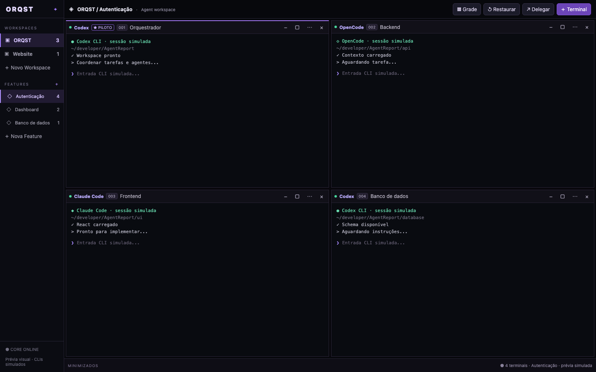
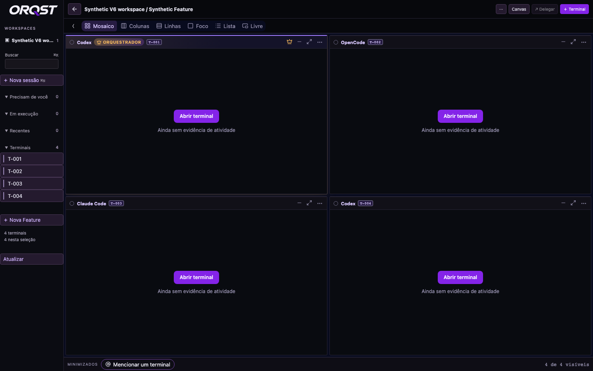
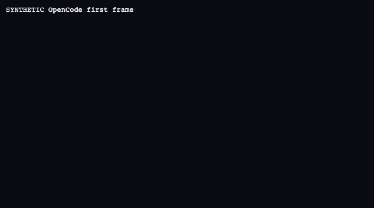

# V6 Studio visual parity

Compared at 1440×900 in Chromium with reduced motion. The reference is the
[approved HTML](../design/v6/source/ORQST_workspace_v6_features.html). The Studio
capture uses the production dashboard entry and the same disposable Bridge and
synthetic Feature facade as the [dashboard alerts review](dashboard-alerts-review.md).
It shows four fixture slots. A separate Chromium test renders the actual Studio
terminal document and xterm with a simulated native opening result.

| Element                  | Approved HTML |        Studio |
| ------------------------ | ------------: | ------------: |
| Feature sidebar          |        155 px |        155 px |
| Feature header           |         45 px |         45 px |
| Pane header              |         31 px |         31 px |
| Stage inset and pane gap | 4 px and 5 px | 4 px and 5 px |
| Minimized dock           |         33 px |         34 px |
| First card top           |         49 px |         85 px |

## Remaining differences

- Studio keeps a 36 px layout toolbar for Mosaic, Columns, Rows, Focus, List
  and Free. The reference fits its two layout controls into the Feature header.
  At 1440×900 the Studio cards therefore start 36 px lower. The dock is one
  pixel taller and carries real visible/total counts plus the existing mention
  entry point. The added toolbar also keeps the Feature-panel toggle available.
- Studio uses the ORQST logo, real terminal IDs and the saved orchestrator label.
  Its sidebar includes session search, terminal scopes and refresh. At 390 px
  the 46 px sidebar wraps long Portuguese labels and the dock can scroll.
- The dashboard-only facade offers a route to the native terminal. In the
  dedicated Studio surface, each body is an owned xterm view. The reference has
  simulated logs, an input field and green dots in every card. The production
  header uses evidenced agent state, so an unknown turn state remains unknown
  while its PTY displays process output. The dashboard facade has no native
  close button and cannot validate native stacking or focus.
- The native card uses the WebView's preferred language and the shipped
  i18next dictionaries. A language override saved only in the dashboard origin
  does not propagate to a dedicated terminal origin. Native menus and provider
  TUI text retain their own language sources.

### Approved HTML at 1440×900



### Production dashboard with synthetic Feature facade at 1440×900



[Compact Studio at 390×844](v6-visual-parity/studio-pt-BR-390.png).

### OpenCode PTY body at card size



## Terminal output and lifecycle

The dedicated [terminal document](../../apps/desktop/src/terminal-document.ts)
had a pair control section even in Studio. Its controller used the same
“attempt ended” guidance for both `exited` and `start_failed`, and changed the
guidance during input revocation. The old locale came from the
[host's LANG environment](../../apps/desktop/src/tauri-terminal-host.ts).
The new Studio card omits the walkthrough. Exit, startup failure and uncertain
ownership each have their own localized feedback based on the matching instance
snapshot. Drawing a previous PTY frame is insufficient evidence of current
liveness. The exact snapshot used by the reported Preview was unavailable here.

The [opening controller](../../apps/desktop/src/managed-terminal-client.ts)
previously treated an incomplete open as having neither input nor output, so it
did not poll the PTY. Its automatic recovery called the
[activated client](../../apps/desktop/src/terminal-client.ts) for attach and
input. Native focus alone does not supply a Chromium or WebKit user activation.
The resulting blank cursor was reproducible with an incomplete opening facade.
No real Preview trace was gathered to determine which intermediate condition
occurred on the owner's T-002.

The [native broker](../../packages/core/src/terminal/native-broker.ts) now
finishes the output portion of the original review on the first eligible read.
The renderer starts at cursor zero and uses the same xterm and bounded output
buffer. Resize uses the measured viewport and tracks the latest acknowledged
size, so a temporary refusal does not lose the initial resize. Input still
requires native focus and its existing lease. The native PTY context menu keeps Hide,
Disconnect output, Stop and Force termination available as distinct actions.

Verification commands for the two renderer paths:

```sh
pnpm exec tsx --test tests/studio-native.test.ts tests/terminal-broker.test.ts
pnpm exec tsx scripts/accept-terminal-open-renderer.ts --authorize-synthetic-terminal-renderer
```

The OpenCode test fixture supplies ANSI-compatible bytes to the actual xterm.
The signed broker test verifies the retained first frame, one launch, no input
lease and refusal after expiry, policy revocation or loss of document authority.
Confirmed real WebKit presentation and provider behavior remain native acceptance.

## Reference review

- Anywh's `TerminalView` uses xterm, FitAddon, ResizeObserver and a relay WebSocket.
  `TerminalPanel` retains sibling panes and closes a tmux-backed session through the
  relay. The ORQST adaptation already uses FitAddon with the signed native PTY
  broker. Keep that adaptation and its attribution. No upstream code was incorporated.
  [TerminalView](https://github.com/anywh-sh/anywh/blob/546f189c04415c3c5af5f40e3931a0a90b9aba31/client/src/components/terminal/TerminalView.tsx),
  [TerminalPanel](https://github.com/anywh-sh/anywh/blob/546f189c04415c3c5af5f40e3931a0a90b9aba31/client/src/components/terminal/TerminalPanel.tsx),
  [Apache-2.0 license and NOTICE findings](../research/v6-terminal-chrome.md#anywh).
- Tucano's `route` and `parseRoute` call an engine for channel speaker selection.
  Keep ORQST's native broker. A channel router does not establish terminal output
  or own PTY layout. [Router](https://github.com/eduwxyz/tucano/blob/0501956d127699300209902e889f3e69a0948766/src/core/router.ts),
  [Apache-2.0 license and NOTICE findings](../research/v6-terminal-chrome.md#tucano).
- Overclock's public pane page illustrates compact independent panes. The approved
  HTML governs the Studio appearance. Source revision and reuse rights for the
  Overclock pane implementation were unavailable. [Overclock panes](https://overclock.sh/features/panes).
